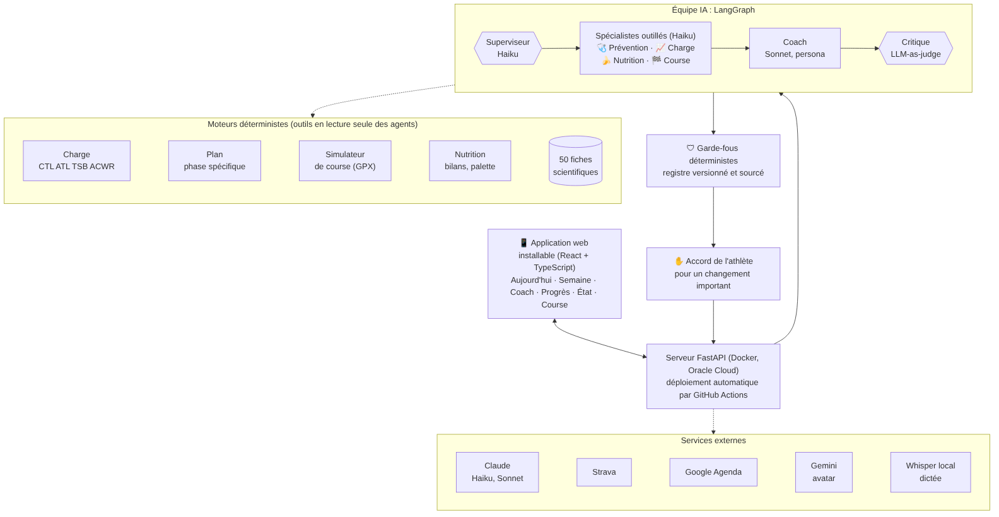
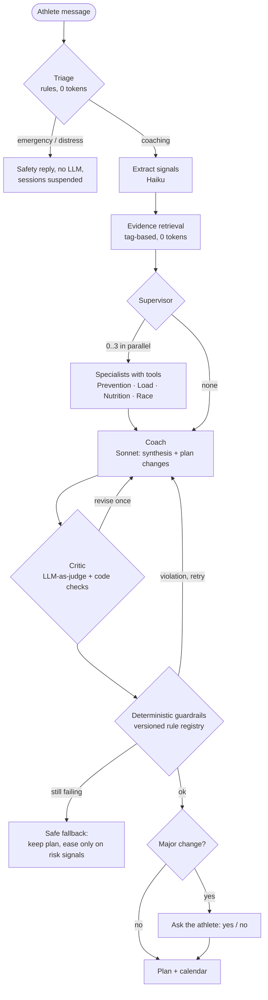

# AI Endurance Coach

A running coach built on Claude, designed for trail and ultra-trail runners. It turns a race goal into a training plan, adapts that plan to what the athlete actually did, and answers in a chat. Deterministic safety code has the final word over the model.

> **Status.** This is a personal prototype. It has run in production every day since October 2026 for two athletes: me, preparing an 85 km / 2,750 m trail race, and my partner, preparing a 21 km. Self-hosted on a small cloud VM.
> It is also my capstone project for the Executive Master in AI at IMT Business School (2026–2027).
>
> **How it was built.** I wrote the specification, chose the architecture and made every design decision; I also did the field testing and audits. Most of the code was written with Claude (Claude Code / Cowork), and the commits say so. The project is as much about directing an AI coding agent toward production quality as about the app itself.

Most of the in-app text and the internal docs are in French, because the athletes are French. This README is the English entry point.

---

## What it does

| Area | What the athlete gets |
|---|---|
| **Onboarding** | Connects Strava. A diagnosis from up to 5 years of history: volume, durability, intensity distribution. Picks a goal race, with a verified catalog for exact race days. A plan is negotiated in chat: training days, club session, maximum weekly volume, holidays. |
| **Plan** | Periodised blocks: recovery, base, speed, race-specific, taper. Session text and duration always match. Heart-rate, pace and effort targets on every session. Writes to Google Calendar. |
| **Daily loop** | Activities sync every 30 min and when the app opens. Each run is matched to the planned session. The session type actually run (easy, tempo, threshold, VO2max, hills) is detected from HR, pace and elevation and compared with the plan. The coach reacts in chat. |
| **Coach chat** | A multi-agent team answers with sourced advice (53 evidence cards with full references). Any plan change shown to the athlete needs a yes/no confirmation. |
| **Race simulator** | GPX import. Split times per aid station for 3 scenarios, cut-off margins, a per-leg nutrition plan, and an interactive elevation profile. |
| **Weekly review** | A Sunday recap: done vs planned, load, next week. The athlete rates fatigue, difficulty and enjoyment, and the coach uses it. |
| **Engagement** | Career levels, trophies and an avatar: optional gamification that rewards consistency, not volume. |

## Architecture



Every athlete message follows the same path:



**Principles**

- **Agents advise, the coach decides, the critic checks, the code enforces, the athlete confirms.** The model never writes to the plan directly. Every proposed change goes through a guardrail registry, where each rule is sourced, versioned and marked as blocking or warning: load spikes (ACWR), pain and illness, no catch-up of missed sessions, taper volume, the longest single run versus the last 30 days, and the athlete's declared weekly maximum.
- **Guardrails apply to the change, not to the existing state.** A rule that the current plan already breaks does not block an unrelated answer. Rules tied to the athlete's own signals (pain, illness, sleep, stress) always block.
- **Graceful degradation.** If Claude is unavailable, a heuristic coach takes over and labels its answers as simplified. Deterministic engines (load, plan, simulator, nutrition) never depend on the LLM.
- **The coach keeps context.** It sees the last 8 chat messages and the athlete's standing preferences, kept separate from the actual plan. A pending yes/no question is always answered before anything else.

**Stack:**
- Backend: Python 3.12, FastAPI, LangGraph (checkpointed graph with interrupts for consent), SQLite.
- Frontend: React 18 + TypeScript (installable PWA).
- Models: Claude (Sonnet for the coach, Haiku for routing, extraction, specialists and the critic).
- Hosting: Docker on Oracle Cloud, deployed automatically by GitHub Actions.

Detailed design in French, written for the master's jury: [`docs/architecture-agents.md`](docs/architecture-agents.md).

## Evaluation

The evaluation compares a single-agent baseline (v0.39) with the multi-agent team (v0.40) on 35 realistic scenarios ([`eval/`](eval)), run offline:

| Metric | Single agent | Multi-agent |
|---|---|---|
| Routing precision / recall | — | 88 % / 97 % |
| Emergency / distress / noise short-circuited | 100 % | 100 % |
| Bad drafts caught by the critic | — | 12 / 13 |
| Unsafe drafts stopped: guardrails alone → critic + guardrails | — | 62 % → 100 % |
| Answers citing at least one evidence card (0 invented cards) | 0 % | 91 % |
| Coverage of expected topics | 56 % | 83 % |
| Estimated cost per message | 0.72 c€ | 1.54 c€ |

These offline runs measure routing, safety layers and non-regression, not the quality of Claude's judgement; live metrics are listed as next steps in the design doc.

## Engineering

- **Tests:**
  - 554 backend tests at 94 % coverage; 143 frontend tests at 96 %.
  - Playwright UI tests on phone and desktop viewports, against a deterministic server: frozen date, fake Strava and calendar, offline coach.
  - Coverage thresholds are enforced in CI.
- **CI/CD:** lint, backend, frontend and UI tests run on every push. A green build moves a `deploy` branch, which the server pulls every 5 minutes.
- **Field feedback loop:** each production issue becomes a regression test before the fix ships. Examples:
  - a threshold session silently downgraded by the coach (v0.50.1);
  - a fallback that rewrote a whole week (v0.50.2);
  - a chat audit that found hallucinated sessions and a lost conversation context (v0.52).

  The full history is in [`docs/CHANGELOG.fr.md`](docs/CHANGELOG.fr.md).
- **Cost control:**
  - a per-day LLM budget;
  - prompt caching;
  - a cheap model for routing and checks;
  - 0-token paths for triage, retrieval and acknowledgements.

  See [`finops.py`](finops.py).

## Known limitations

- **Data source compliance.** Activities come from the Strava API. Strava's API policy (effective 1 June 2026) does not allow API data to be used in AI applications. That makes this a personal prototype only. The plan is to move to watch-maker APIs (Suunto, Garmin, Coros, Polar) and FIT-file import, which already works, before any wider use.
- **Single-tenant.** Each athlete gets their own instance. Scaling would need multi-tenant accounts and webhook-based sync.
- **Offline evaluation only** so far. The next step is live metrics: revision rate, false positives, latency and real cost.
- **The evidence cards** are syntheses written for the project, with full references. They are marked "to be reviewed by a coach" before any non-pilot use.

## Decisions and lessons learned

<!-- TO WRITE (Pierre-Yves, in your own words): 4–6 short paragraphs. Suggested prompts:
     - Why deterministic guardrails have the final word, and one case where that mattered.
     - What the field audits taught you about agent behaviour in long conversations (v0.50.x, v0.52).
     - Single agent vs multi-agent: what you gained, what it cost, and whether you would do it again.
     - How you directed Claude as a coding agent: specs, tests first, audits, and when you had to step in.
     - Discovering the Strava AI clause late, and what you would check first next time.
     - What you would do differently if a customer's team had to run this. -->

## Run it locally (demo, no API key)

```bash
python -m venv .venv && . .venv/bin/activate
pip install -r requirements.txt -r requirements-dev.txt
(cd frontend && npm ci && npm run build)
python e2e/server.py --port 8931     # offline coach, fake Strava, seeded athlete
# open http://127.0.0.1:8931 — passcode: code-test-1234
# POST /__e2e/reset?state=onboarded to start from a ready plan, ?state=fresh for onboarding
```

Run the tests:

```bash
python -m pytest -q --cov=coach                       # backend
(cd frontend && npx vitest run)                       # frontend
(cd e2e && npm ci && npx playwright install chromium && npx playwright test)   # UI
```

For a real deployment with Claude, Strava and Google Calendar, see [`GUIDE_SERVEUR.md`](GUIDE_SERVEUR.md) (in French).

---

Pierre-Yves Klein. Personal project, not affiliated with Strava or any watch maker.
