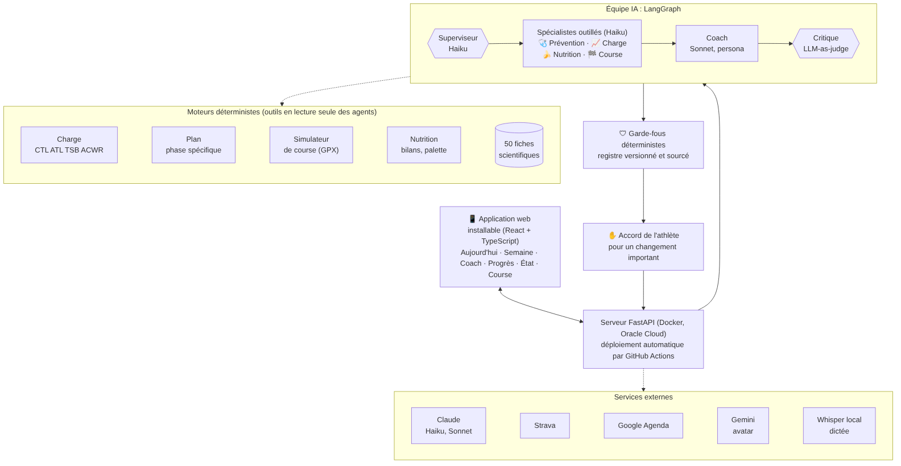
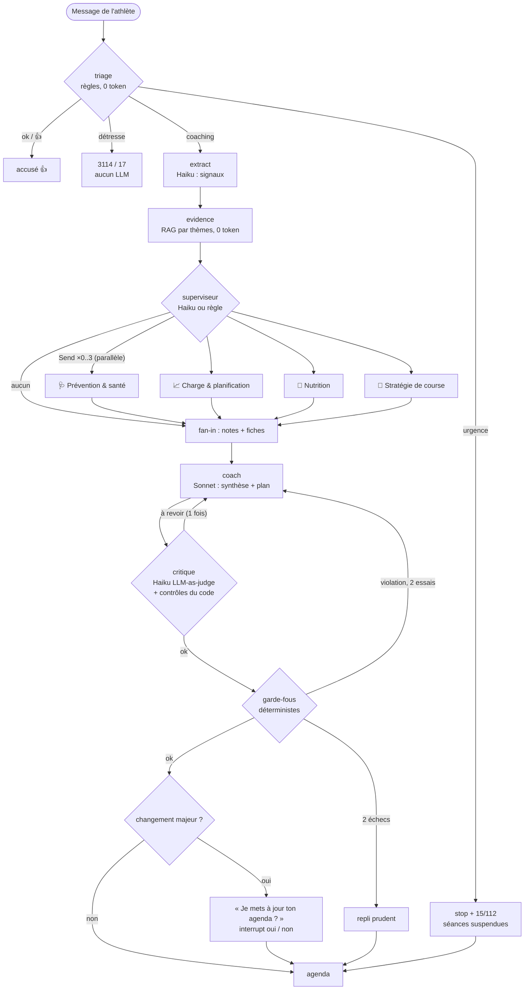

# Architecture multi-agents du coach (v0.41)

Document pour le jury IMT BS (Executive Master IA, projet fil rouge). Il décrit l'équipe d'agents qui produit
chaque réponse du coach, ses outils, ses couches de sécurité, son coût, et la façon de la mesurer.

Le code est dans `coach/agents/` (le pipeline v0.39 à un seul agent reste disponible : `COACH_AGENTS=single`,
pour l'évaluation A/B).

## 0. Pourquoi plusieurs agents ?

Jusqu'à v0.39, un seul appel « coach » (Sonnet) recevait tout : charge, plan, signaux, fiches, nutrition,
objectif. Trois limites mesurables en sont sorties : (1) le prompt grossit à chaque fonctionnalité et le modèle
oublie des domaines (couverture des thèmes attendus : 56 %) ; (2) les affirmations ne sont pas reliées à des
sources (0 % de réponses citant une fiche dans l'évaluation) ; (3) la seule barrière avant l'athlète est le code
des garde-fous, qui ne voit que le plan, pas le texte (conseils dangereux, glucides excessifs, fiches inventées).

Le découpage multi-agents répond à chacune : des **spécialistes** à petit contexte, outillés, qui vont chercher
eux-mêmes les données utiles (tool use) et citent leurs fiches ; un **superviseur** qui n'en consulte que 0 à 3
(coût maîtrisé) ; un **critique** (LLM-as-judge) qui relit le texte avant les garde-fous. Le coach reste le seul
interlocuteur de l'athlète, et le code déterministe reste l'autorité finale : la chaîne est
**agents conseillent → coach décide → critique vérifie → garde-fous imposent → l'athlète confirme**.

## 1. Vue d'ensemble



Parcours d'un message (image : `schema-parcours-message.png`, source ci-dessous) :



Graphe LangGraph réel (généré) : `graph.mmd`. Les spécialistes sont lancés par `Send` (fan-out) et tournent
dans des fils parallèles ; leurs notes sont fusionnées par un réducteur (`add_notes`) au nœud `team` (fan-in).

## 2. Les agents

| Agent | Modèle | Rôle | Sortie structurée |
|---|---|---|---|
| Superviseur | Haiku 4.5 (small) | Choisit 0 à 3 spécialistes et dit pourquoi. Raccourcis par règle pour les cas évidents (déplacement de séance, bilan nutrition, retour de séance, message sans enjeu) : 0 token, décision quand même journalisée. Filet de sécurité codé : un signal de santé ajoute toujours Prévention. | `RoutingDecision {specialists, reason}` |
| 🩺 Prévention & santé | Haiku 4.5 | Douleur, maladie, sommeil, stress, alcool, RPE, dérive cardiaque. Peut poser un **veto** (pas d'intensité). | `SpecialistNote` + `veto`, `veto_reason` |
| 📈 Charge & planification | Haiku 4.5 | ACWR, TSB, plan 7 jours, sorties récentes, assiduité ; teste un changement candidat contre les garde-fous. | `SpecialistNote` |
| 🍌 Nutrition | Haiku 4.5 | Bilans nutrition (g/h, digestion), aliments tolérés, cible de glucides (≤ 120 g/h), plan de course. | `SpecialistNote` |
| 🏁 Stratégie de course | Haiku 4.5 | Objectif et jours restants, phase (foncière, spécifique, affûtage), simulateur de course, chronos estimés. | `SpecialistNote` |
| Coach (synthèse) | Sonnet 5 (main) | Seul à parler à l'athlète : message + changements du plan, dans le ton du persona (le persona ne change que le ton, jamais la sécurité). Cite les fiches. | `CoachDecision` |
| Critique | Haiku 4.5 | LLM-as-judge du brouillon : fondé, cohérent avec l'équipe, sûr, veto respecté, changements justifiés. `revise` = 1 seule révision. | `CriticVerdict {verdict, reasons}` |

`SpecialistNote = {findings, recommendations, risks, evidence_ids, confidence}` + `risk_level (low|medium|high)`
et, pour Prévention, `veto` / `veto_reason`. Les `evidence_ids` sont filtrés : seule une fiche réellement
renvoyée par `knowledge_search` pendant la boucle peut être citée.

### Outils (vraies fonctions Python, `coach/agents/tools.py`)

| Spécialiste | Outils |
|---|---|
| Tous | `knowledge_search(tags, query, k)` : 50 fiches scientifiques sourcées (`coach/knowledge.py`) ; les `id` cités sont vérifiés (une fiche inconnue est retirée et signalée). |
| Charge | `load_state`, `plan_7d` (7 à 14 jours, avec titres), `weekly_loads`, `recent_activities`, `plan_adherence`, `guardrails_dry_run` (le changement candidat passe dans les VRAIS garde-fous, sans être appliqué) |
| Nutrition | `nutrition_logs`, `food_palette`, `target_carbs`, `race_nutrition_plan` |
| Course | `main_goal`, `race_simulation` (simulateur v0.38 : temps des 3 scénarios, marges aux barrières horaires, plus grosses montées), `specific_phase`, `progress_estimates` |
| Prévention | `wellbeing_signals` (avec les seuils du registre de règles), `recent_feedback`, `hr_drift`, `load_state` |

Tous les outils sont **en lecture seule** (test : aucune écriture SQL pendant un spécialiste) ; seul le chemin
déterministe guard → confirm → calendar modifie le plan.

Boucle d'outils (`LLMPort.tool_loop(node, tier, system, user, tools, schema, max_steps)`, `coach/llm.py`) : `tool_choice: any` (le modèle doit appeler un outil de
données ou la réponse finale), on exécute la fonction, on renvoie `tool_result`, au plus 4 allers-retours ; au
dernier, la réponse finale est forcée. Prompt système et définitions d'outils sont en cache (préfixe commun à
tous les athlètes). Chaque aller-retour est journalisé sous le nom de l'agent (`spec_nutrition`…) : coût par agent.
`FallbackLLM` replie agent par agent sur l'équipe hors ligne (`coach/agents/offline.py`) ; `HeuristicLLM` et
`MockLLM` choisissent les outils par règles déterministes (hors ligne, CI). Les modèles qui refusent
`tool_choice` forcé (`_FORCED_TOOL_UNSUPPORTED`, Sonnet 5.5) lèvent `NotImplementedError` (migration à faire).
Les outils ne prennent jamais le verrou du service et la base SQLite est protégée par un verrou de connexion
(lectures parallèles sûres).

## 3. Couches de sécurité (de la plus précoce à la dernière)

1. **Triage par règles** (0 token) : urgence (douleur thoracique, syncope…) → arrêt + 15/112 et séances
   suspendues ; détresse → 3114/17, aucun LLM, aucun changement de plan ; bruit → 👍.
2. **Veto de Prévention** : douleur > seuil du registre (3/10), maladie, alcool important, nuit très courte,
   fatigue extrême → le coach ne propose aucune intensité.
3. **Critique** (LLM-as-judge + contrôles déterministes que le LLM ne peut pas lever) : veto non respecté,
   rattrapage (avec gestion des négations : « pas de rattrapage » passe), > 120 g/h, conseil médical ou dangereux
   (« serre les dents », anti-inflammatoire), fiche citée inexistante, contradiction avec Nutrition, séance
   inconnue du plan. Une révision au plus ; le budget de rédactions du coach (2 par message) est partagé avec
   les garde-fous.
4. **Garde-fous déterministes** (`coach/guardrails.py`, registre versionné `coach/rules_registry.py`) :
   **autorité finale**. Ils évaluent le plan résultant complet ; 2 essais puis repli prudent. Le critique ne
   les remplace jamais (test : un critique « trompé » laisse passer, les garde-fous bloquent quand même).
5. **Confirmation oui / non** de l'athlète pour tout changement majeur (interrupt LangGraph, persistant).

## 4. Traçabilité

Chaque message du coach porte dans `meta` : `routing {specialists, reason, by}`,
`agents [{name, label, icon, reason, tools [{name, ms}], risks, risk_level, veto, veto_reason, evidence_ids, cost_eur, ms}]`,
`critic {verdict, reasons, revised, rounds}`, `cost_by_agent`. L'interface (chat → « détails ») affiche les
avatars de l'équipe, la ligne « Équipe consultée : Nutrition (4 outils) · Prévention (3 outils) · Critique :
validé après 1 révision », puis pour chaque agent ses outils et leur durée, son niveau de risque, son veto,
ses fiches et son coût, avec des puces « 🩺 Prévention · 3 outils · 0,12 c€ · 0,4 s », le verdict du critique
et le coût total du message. Réglages › Application montre le mode (`COACH_AGENTS`) et la composition de
l'équipe (rôle, petit / grand modèle, outils).

## 5. « Œil du coach » (usage phare de toute l'équipe)

v0.41 : **la première analyse est offerte dès l'inscription** (le coach l'annonce quand le premier plan est adopté ;
une analyse qui échoue n'est pas décomptée, clé `eye_welcome_used`), pour faire découvrir l'équipe d'agents ; ensuite,
débloqué au niveau de carrière 7 (`EYE_LEVEL`, variable `COACH_EYE_LEVEL`), une analyse tous les 30 jours
(`COACH_EYE_EVERY_DAYS`) ; décrit dans « Les règles du jeu » de la Carrière.
`POST /api/eye` (409 si verrouillé, trop tôt, déjà en cours ou budget atteint) lance en tâche de fond un second
graphe LangGraph : les 4 spécialistes en parallèle sur des fenêtres de 8 semaines (activités, assiduité,
retours, bilans nutrition, objectif + simulateur) → le coach (Sonnet) rédige
`{summary, strengths, weaknesses, risks, nutrition, race, priorities[3] (action, pourquoi, fiches), to_measure,
next_review}`
→ le critique vérifie (3 priorités citées, rien de dangereux) → 1 révision au plus. Le rapport est enregistré
avec historique (12 derniers rapports, `GET /api/eye` → `history`), un court message du coach dans le chat y
renvoie (carte « L'œil du coach » de l'onglet Progrès : verrou + progression XP, ou bouton et rapport en
sections repliables). Coût estimé : ≈ 5,9 c€ par analyse (`finops.eye_eur`), soit < 6 c€ par athlète et par mois.

## 6. Coût (FinOps)

Modèle explicite dans `finops.py` (`TeamBudget`, `per_message_eur`) ; prix sept. 2026 (Haiku 4.5 $1/$5,
Sonnet 5 $2/$10 par MTok, cache −90 %).

| Par message de coaching | single (v0.39) | multi (v0.40) |
|---|---|---|
| Extraction (Haiku) | 0,13 c€ | 0,13 c€ |
| Superviseur (Haiku, 60 % des messages) | — | 0,07 c€ |
| Spécialistes (1,4 × 2,2 allers-retours, Haiku) | — | 0,61 c€ |
| Coach (Sonnet) | 1,95 c€ | 2,23 c€ |
| Critique (Haiku) | — | 0,37 c€ |
| **Total** | **2,08 c€** | **3,41 c€** |

Soit +1,3 c€ par message, ≈ +0,26 €/athlète/mois (≈ 20 échanges utiles), pour une marge brute qui reste
largement positive. Leviers : seul le coach est sur le gros modèle ; raccourcis par règle (0 token) ; critique
sans appel LLM quand il n'y a rien à confronter ; budget quotidien inchangé (`COACH_DAILY_BUDGET_EUR`).

## 7. Évaluation (`eval/agents_eval.py`)

35 scénarios réalistes (`eval/agents_scenarios.jsonl`) avec propriétés attendues : spécialistes attendus
(et tolérés), interdits (intensité avec douleur / maladie / alcool / manque de sommeil, rattrapage,
> 120 g/h, intensité ajoutée), thèmes à mentionner, urgences et détresse, et 17 brouillons piégés (13 mauvais : intensité malgré douleur, alcool, fièvre, rattrapage, 150 g/h, fiche
inventée, « serre les dents », anti-inflammatoire… ; 4 sains) pour mesurer le critique. Les contrôles de l'évaluation sont indépendants de ceux du critique.

```bash
python -m eval.agents_eval          # hors ligne, déterministe, 0 € (aussi exécuté par pytest)
python -m eval.agents_eval --live   # vrai Claude (ANTHROPIC_API_KEY), écrit eval/reports/agents-<date>-live.*
```

Résultats hors ligne (`eval/reports/agents-2026-11-04.md`) :

| Métrique | single (v0.39) | multi (v0.40) |
|---|---|---|
| Routage : précision / rappel / ensemble exact | — | 88 % / 97 % / 84 % |
| Spécialistes consultés par message | — | 1,34 |
| Violations remises aux garde-fous | 1 | 0 |
| **Violations finales (après garde-fous)** | **0** | **0** |
| Urgence / détresse / bruit court-circuités | 100 % | 100 % |
| Critique : brouillons mauvais détectés | — | 12/13 (92 %) |
| Garde-fous seuls / critique + garde-fous | — | 62 % / 100 % |
| Fausses alertes du critique (brouillons sains) | — | 0/4 |
| Réponses citant ≥ 1 fiche (fiches inexistantes : 0) | 0 % | 91 % |
| Couverture des thèmes attendus | 56 % | 83 % |
| Appels LLM par message | 2,03 | 5,25 |
| Coût par message (tokens estimés) | 0,72 c€ | 1,54 c€ |

Le seul brouillon manqué (`rajouter_vma` : séance de VMA ajoutée sans justification) est bloqué par les
garde-fous : c'est exactement la complémentarité recherchée. Le test
`tests/test_v040_agents.py::test_offline_agents_evaluation_meets_the_thresholds` verrouille ces seuils.

**À valider en live** (le hors ligne valide la mécanique, pas la qualité rédactionnelle de Claude) : qualité
du routage LLM, nombre réel d'allers-retours d'outils, taux de révision du critique et faux positifs, coût et
latence réels (cible < 15 s par message, spécialistes en parallèle), comportement de Haiku avec
`tool_choice: any`.

## 7 bis. Limites

- Hors ligne, les « agents » sont des règles : l'évaluation prouve la mécanique (routage, outils, fan-out,
  critique, sécurité) et la non-régression, pas la finesse du jugement de Claude. Les coûts hors ligne sont
  estimés depuis la taille des prompts.
- Le critique déterministe repère des motifs (négations comprises) ; une incohérence subtile demande le
  jugement LLM, à mesurer en live (faux positifs, révisions inutiles).
- Le routage par règles favorise le rappel (sécurité) au prix de quelques consultations en trop (précision 88 %).
- Latence : en live, superviseur + spécialistes en parallèle + critique ajoutent ≈ 2 appels séquentiels Haiku au
  tour (estimation 4-8 s) ; le tour est déjà en tâche de fond avec indicateur « le coach écrit ».
- Pas encore d'agent « Psychologie & motivation » : la motivation basse est traitée par Charge (séances libres)
  et Prévention (stress) ; à ajouter si l'évaluation live montre un manque.
- Sonnet 5.5 n'accepte pas `tool_choice` forcé : migration (`tools strict` + `tool_choice auto`) requise avant usage.

## 8. Fichiers

- `coach/agents/` : `schemas.py` (contrats), `roster.py` (rôles, prompts), `tools.py` (outils), `data.py`
  (port de données), `team.py` (nœuds LangGraph), `offline.py` (équipe hors ligne + contrôles du critique),
  `trace.py` (méta des messages), `eye.py` (Œil du coach).
- `eval/agents_eval.py`, `eval/agents_scenarios.jsonl`, `eval/reports/`, `finops.py` (`TeamBudget`, `eye_eur`).
- `coach/llm.py` (boucle d'outils, repli agent par agent), `coach/graph.py` (`COACH_AGENTS`),
  `coach/web/eye_flow.py`, `coach/web/app.py` (`/api/eye`), `frontend/src/components/TeamTrace.tsx`,
  `frontend/src/components/EyeCard.tsx`, `frontend/src/views/Details.tsx` (panneau Agents).
